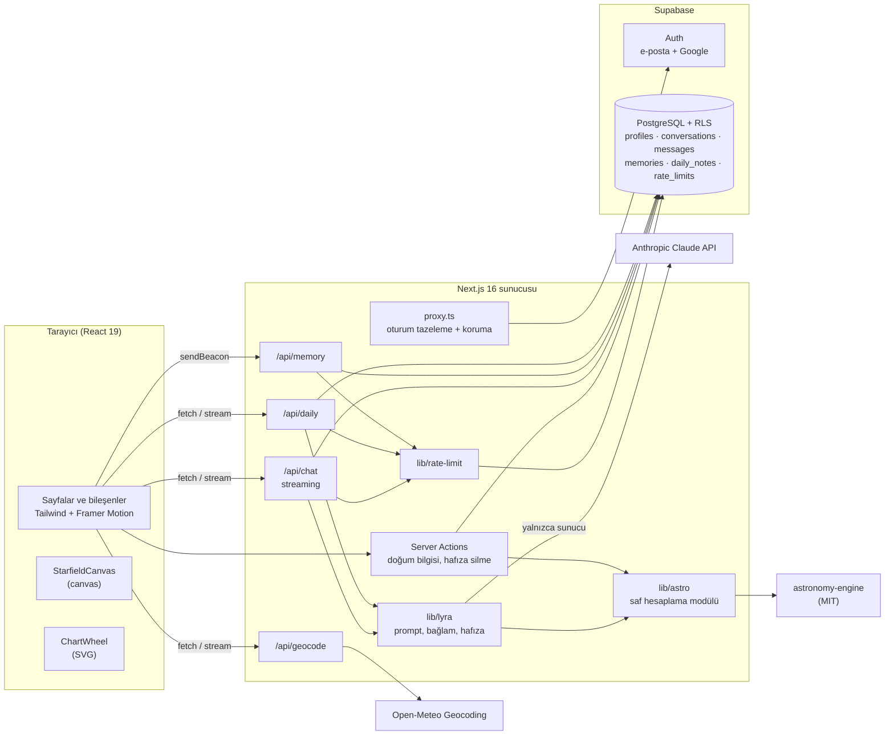
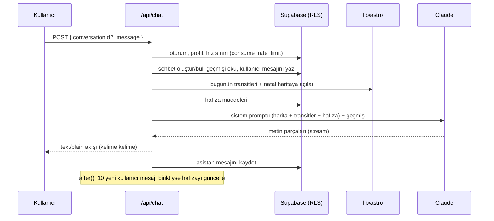

# ✨ Lyra — Yapay Zekâ Destekli Kişisel Astrolog

Lyra, doğum bilgilerinden **gerçek astronomik hesaplamayla** doğum haritası çıkaran, bu haritayı bilen ve
**önceki sohbetleri hatırlayan** bir yapay zekâ astrologla konuşmanı sağlayan bir web uygulamasıdır.

> Gece gökyüzü temalı, mobil öncelikli, tamamen Türkçe bir arayüz: hareketli yıldız alanı, cam efektli kartlar,
> interaktif SVG doğum haritası ve kelime kelime akan sohbet.

## Ekran görüntüleri

| Karşılama | Doğum haritası | Lyra ile sohbet |
| --- | --- | --- |
| _`docs/screenshots/landing.png`_ | _`docs/screenshots/chart.png`_ | _`docs/screenshots/chat.png`_ |

| Doğum bilgisi sihirbazı | Panel ve günlük özet | Hafıza yönetimi |
| --- | --- | --- |
| _`docs/screenshots/wizard.png`_ | _`docs/screenshots/dashboard.png`_ | _`docs/screenshots/memory.png`_ |

## Özellikler

- **Doğum haritası:** Güneş'ten Plüton'a 10 gezegen (burç, derece, retro), yükselen, MC, 12 ev (Placidus) ve
  5 ana açı (kavuşum, karşıt, üçgen, kare, altmışlık). Doğum saati bilinmiyorsa evler ve yükselen hesaplanmaz,
  arayüzde ve Lyra'nın bağlamında bu açıkça belirtilir.
- **İnteraktif harita:** SVG çember. Bir gezegenin üzerine gelince ya da dokununca açıklaması ve açıları vurgulanır.
- **Lyra sohbeti:** Claude API ile streaming cevaplar. Her istekte doğum haritası, o günün gökyüzü, natal
  haritaya yapılan transit açılar ve kullanıcı hafızası yapılandırılmış biçimde sistem promptuna eklenir.
- **Hafıza:** Ayrı bir LLM çağrısı, sohbetten kalıcı bilgileri, takip edilecek konuları ve Lyra'nın önemli
  yorumlarını çıkarıp önceki hafızayla birleştirir. Kullanıcı hafızasını ayarlardan görebilir, tek tek silebilir ya da sıfırlayabilir.
- **Günlük özet:** Öne çıkan transitler ve Lyra'nın kısa notu. Kullanıcının saat diliminde günde bir kez üretilir ve veritabanında önbelleğe alınır.
- **Güvenlik:** Supabase Row Level Security, yalnızca sunucu tarafında yapılan LLM çağrıları ve kullanıcı başına hız sınırı.

## Mimari



### Bir sohbet isteğinin akışı



## Teknoloji yığını

| Katman | Seçim |
| --- | --- |
| Uygulama | Next.js 16 (App Router, Turbopack), React 19, TypeScript (strict) |
| Stil ve animasyon | Tailwind CSS v4, Framer Motion, Cormorant Garamond + Inter |
| Kimlik ve veri | Supabase Auth (e-posta + Google), PostgreSQL, Row Level Security |
| Astronomi | [astronomy-engine](https://github.com/cosinekitty/astronomy) (MIT) + kendi Placidus ve açı hesaplamaları |
| Saat dilimi | Luxon (IANA, tarihsel yaz saati kuralları dahil) |
| LLM | Anthropic Claude (`@anthropic-ai/sdk`), streaming ve server-side refusal fallback |
| Test | Vitest |

### Neden Swiss Ephemeris değil?

Swiss Ephemeris **AGPL** ya da ücretli ticari lisansla dağıtılıyor. AGPL, uygulamanın kaynak kodunun açılmasını gerektiriyor.
Lyra bunun yerine MIT lisanslı **astronomy-engine** kullanıyor. Astrolojik doğruluk için yeterince hassas
(gezegenlerde ±1 yay dakikası mertebesinde). Ev sistemi astronomy-engine'de olmadığı için Placidus
(`src/lib/astro/houses.ts`) iteratif olarak sıfırdan yazıldı. |enlem| ≥ 66° olduğunda Placidus tanımsız kalıyor,
bu durumda hesaplama otomatik olarak Whole Sign'a geçiyor.

## Klasör yapısı

```
src/
├── app/
│   ├── page.tsx                 # Karşılama sayfası
│   ├── (auth)/                  # /giris, /kayit + server actions
│   ├── auth/callback/           # OAuth ve e-posta onay dönüşü
│   ├── (app)/                   # Oturum gerektiren alan
│   │   ├── baslangic/           # Doğum bilgisi sihirbazı
│   │   ├── panel/               # Ana panel + günlük özet
│   │   ├── harita/              # Doğum haritası
│   │   ├── sohbet/[id]/         # Lyra sohbeti + geçmiş
│   │   └── ayarlar/             # Profil + hafıza yönetimi
│   └── api/                     # chat · memory · daily · geocode
├── components/                  # ui, icons (elle çizilmiş SVG), cosmos, chart, chat
├── lib/
│   ├── astro/                   # Saf hesaplama modülü + testler
│   ├── lyra/                    # Sistem promptu, bağlam, hafıza, günlük not
│   ├── supabase/                # Sunucu ve tarayıcı istemcileri
│   ├── db.ts · errors.ts · rate-limit.ts · session.ts
└── proxy.ts                     # Next 16 proxy (eski middleware)
supabase/migrations/             # Şema + RLS politikaları
```

## Kurulum

### 1. Gereksinimler
- Node.js 20.9 veya üzeri
- Bir [Supabase](https://supabase.com) projesi (ücretsiz plan yeterli)
- Bir [Anthropic API anahtarı](https://console.anthropic.com)

### 2. Bağımlılıklar
```bash
npm install
```

### 3. Ortam değişkenleri
```bash
cp .env.example .env.local
```
`.env.local` dosyasına Supabase URL'i ve anon key'i (**Project Settings → API**) ile `ANTHROPIC_API_KEY` değerini gir.
Varsayılan model `claude-opus-5-5`. İstersen `LYRA_CHAT_MODEL` ve `LYRA_UTILITY_MODEL` ile değiştirebilirsin.

### 4. Veritabanı
`supabase/migrations/` altındaki SQL dosyalarını sırayla uygula:
- **Supabase CLI ile:** `supabase link --project-ref <ref>` ve ardından `supabase db push`
- **Elle:** Dashboard → SQL Editor'de dosyaları numara sırasıyla çalıştır.

### 5. Kimlik doğrulama
- **Authentication → URL Configuration:** Site URL `http://localhost:3000`, Redirect URL `http://localhost:3000/auth/callback`
- **Google:** Authentication → Providers → Google'ı aç. Google Cloud'da OAuth istemcisi oluştur ve yönlendirme
  adresi olarak Supabase'in verdiği callback URL'ini ekle.
- Geliştirme sırasında e-posta onayını kapatırsan kayıt olduktan sonra doğrudan sihirbaza geçersin.

### 6. Çalıştır
```bash
npm run dev          # http://localhost:3000
npm test             # birim testleri
npm run typecheck && npm run lint && npm run build
```

## Hesaplama modülü ve testler

`src/lib/astro` UI'dan ve veritabanından bağımsız, saf TypeScript bir modül:

| Dosya | Görev |
| --- | --- |
| `positions.ts` | Jeosantrik görünür tropikal boylamlar, günlük hız, retro durumu |
| `houses.ts` | RAMC, yükselen, MC, Placidus (iteratif) ve Whole Sign'a geçiş |
| `aspects.ts` | Natal ve transit açılar, orblar, yaklaşma/ayrılma |
| `chart.ts` | `computeNatalChart`, `computeTransits` |
| `format.ts` | LLM promptu için sabit biçimli metin |
| `time.ts` | Yerel saatten UTC'ye çeviri (Luxon, tarihsel saat dilimleri) |

Testler (`npm test`, 31 test):
- **Einstein** (14.03.1879, Ulm): 10 gezegen, yükselen ve MC astro.com referans değerleriyle ±0,5° (açılarda ±1°) içinde eşleşiyor.
- 2024 ekinoksu ve gündönümünde Güneş'in konumu, Merkür retrosu
- Doğum saati bilinmeyen haritada ev ve yükselen olmaması
- Yüksek enlemde Whole Sign'a geçiş (Tromsø)
- İstanbul'un 2016 öncesi yaz saati ve sonrasındaki sabit +3 dönüşümleri
- Sistem promptundaki tüm yer tutucuların doldurulması

## Güvenlik ve gizlilik

- **RLS:** Her tabloda kullanıcı yalnızca `auth.uid()` ile eşleşen satırlara erişebilir. `messages` eklenirken
  sohbetin de aynı kullanıcıya ait olduğu doğrulanır. `rate_limits` tablosuna doğrudan erişim yok; sayaç yalnızca
  `security definer` bir fonksiyonla artırılabiliyor.
- **API anahtarı:** Claude çağrıları yalnızca sunucuda yapılır. `lib/lyra/anthropic.ts` dosyasındaki `server-only`
  importu, anahtarın istemci paketine sızmasını derleme aşamasında engeller.
- **Hız sınırı:** Sohbet için saatte 30, günde 150 mesaj. Hafıza, günlük not ve şehir arama için ayrı kovalar var.
- **Hafıza şeffaflığı:** Kullanıcı Lyra'nın neyi hatırladığını görür ve dilediğini siler.

## Lisans
MIT
